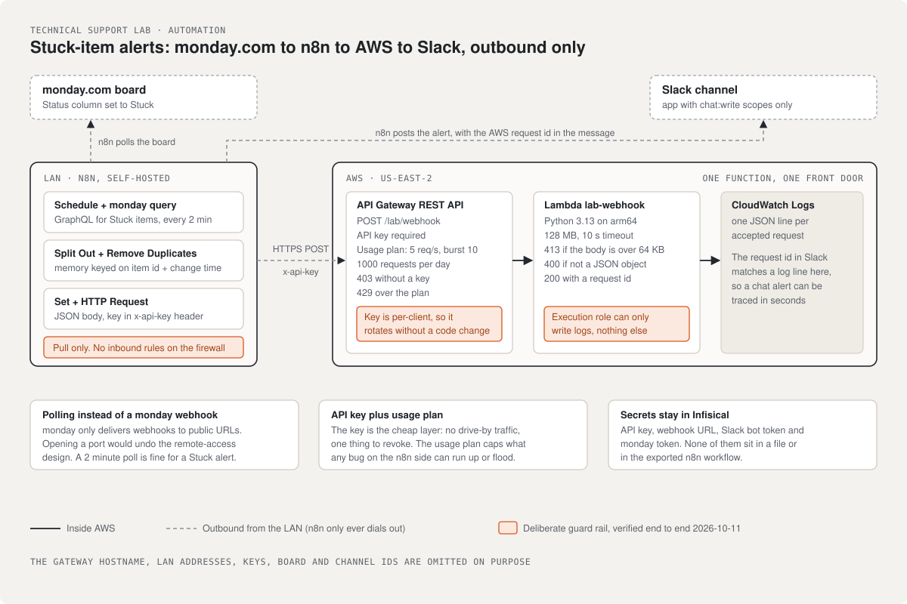
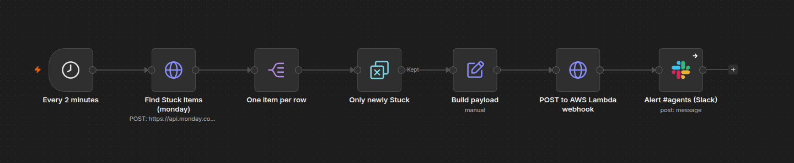
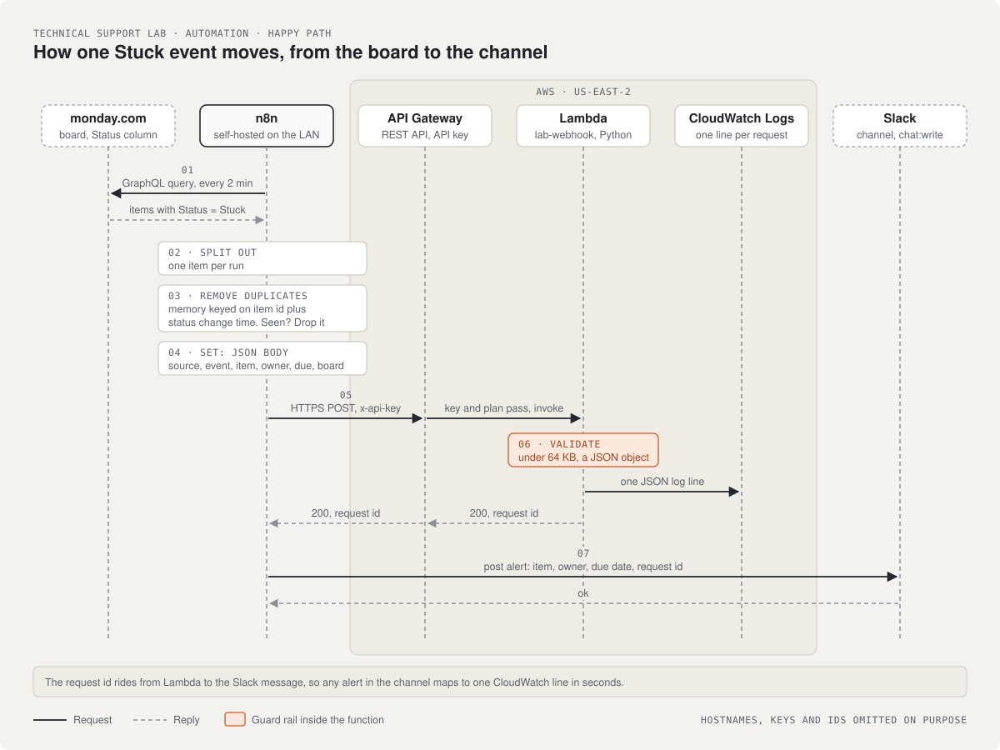
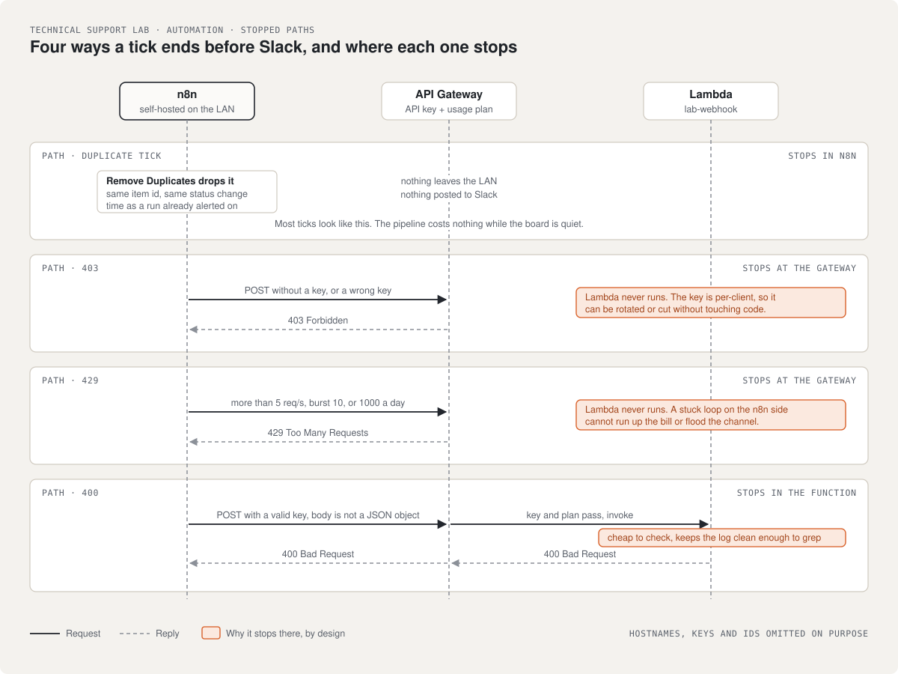

# Stuck-item alerts: monday.com to n8n to AWS to Slack

The first automation in the technical support lab that leaves the LAN. When someone sets an item to Stuck on a monday.com board, a self-hosted n8n workflow catches it within two minutes, posts the event to a Lambda function behind API Gateway, and tells a Slack channel with the AWS request id attached. Built 2026-10-11, verified end to end the same day.

## Why this exists

I wanted a small pipeline that touches the tools clients and job postings keep asking for (n8n, AWS Lambda, API Gateway, Slack, monday.com) and that I could explain down to the error codes. A webhook receiver is the right size for that. It's one function behind one front door, and it has enough ways to fail that writing them down is worth it.

I don't write Python by hand. I direct AI coding agents, review what they produce, and run the tests myself. The handler, the n8n workflows and this page came out of that loop. I read every number on this page back from the running systems before writing it down.

## At a glance

| | |
|---|---|
| **Trigger** | monday.com board, Status column set to Stuck |
| **Workflow** | n8n, self-hosted on the lab LAN. Polls every 2 minutes, splits items, drops ones already alerted, builds the payload |
| **Front door** | API Gateway REST API in us-east-2, `POST /lab/webhook`, API key required, usage plan 5 requests/s, burst 10, 1000/day |
| **Function** | Lambda `lab-webhook`, Python 3.13 on arm64, 128 MB, 10 s timeout, execution role that can only write logs |
| **Log** | CloudWatch Logs, one JSON line per accepted request |
| **Notify** | Slack app with `chat:write` and `chat:write.public` only, posts item, owner, due date and request id |
| **Secrets** | API key, webhook URL, Slack bot token and monday token live in Infisical. None of them are in a file or in the n8n export |

## The workflow in n8n

The live canvas. The API Gateway hostname under the AWS node is painted out.

## How a Stuck event moves

1. Every 2 minutes n8n runs a GraphQL query against the board for items whose Status is Stuck.
2. Split Out turns the list into one item per run.
3. Remove Duplicates keeps a memory across executions keyed on item id plus the status change timestamp. If it's the same item and the same change, it's dropped. Same item set Stuck again next week: new timestamp, so it alerts again.
4. A Set node builds the JSON body: source, event, item, owner, due, board.
5. HTTP Request posts it to API Gateway with the key in an `x-api-key` header. The credential is domain-locked in n8n so the key can't be sent anywhere else.
6. Lambda rejects anything over 64 KB (413), anything that isn't JSON (400), anything that isn't a JSON object (400). Otherwise it logs one line and returns 200 with a request id.
7. The Slack node posts the alert with that request id, so a message in the channel can be matched to a CloudWatch line in seconds.

## The paths that don't end in Slack

| What happens | Where it stops | Why it's that way |
|---|---|---|
| Tick finds 0 new Stuck items | After Remove Duplicates. Nothing posted | Most ticks look like this. The pipeline costs nothing when the board is quiet |
| Request without a key | API Gateway, 403. Lambda never runs | The function is not reachable without the key, and the key is per-client, so it can be rotated or cut without touching code |
| More than the usage plan allows | API Gateway, 429 | A stuck loop on my side can't run up the bill or flood the channel |
| Body is not a JSON object | Lambda, 400 | Cheap to check, and it keeps the log clean enough to grep |

## Design decisions

**Polling instead of a monday webhook.** monday.com only delivers webhooks to public URLs, and n8n sits on the LAN behind the firewall with no inbound rules (see [remote-access.md](../remote-access.md)). Opening a port for this would undo the point of that page. A 2 minute poll is fine for a Stuck alert.

**Why an API key and a usage plan.** The key is the cheap layer: it stops drive-by traffic and gives me a per-client thing to revoke. The usage plan is the expensive-mistake layer: it caps what any bug of mine can do. For a client's production traffic I'd add IAM auth or signed requests in front and keep the secret in Secrets Manager.

**64 KB body cap in the function.** API Gateway already limits payloads, but the function enforcing its own limit means the behavior stays the same if the front door changes later.

**Logs-only execution role.** The function has nothing to talk to. Giving it only `AWSLambdaBasicExecutionRole` means a bug in the handler can't reach anything else in the project.

**Request id in the Slack message.** Debugging a chat alert without a handle to the server side is guesswork. The id is free; CloudWatch already has it.

## Files

| File | What it is |
|---|---|
| [handler.py](handler.py) | The Lambda. Validate size and JSON, log, acknowledge |
| [n8n/monday-stuck-alert.json](n8n/monday-stuck-alert.json) | The polling workflow, exported from n8n. Credential and board ids replaced with placeholders |
| [n8n/aws-webhook-relay.json](n8n/aws-webhook-relay.json) | A simpler inbound relay built first to prove the n8n to AWS leg on its own |
| [n8n/slack-app-manifest.json](n8n/slack-app-manifest.json) | The Slack app, two scopes, nothing else |
| [diagrams/](diagrams/) | Hand-written SVG diagrams, plus the n8n canvas screenshot |

Left out on purpose: the API Gateway hostname, the LAN address of n8n, credential ids, the board and channel ids, and the Infisical project. The teardown script that deletes all of it is also kept out, since it names those.

## What I'd do next

Rebuild the same flow in Zapier and in Make so I can say from experience where each one is the better fit, and wire a second event type (overdue items) through the same function to see whether the one-function design holds up or wants a router.
